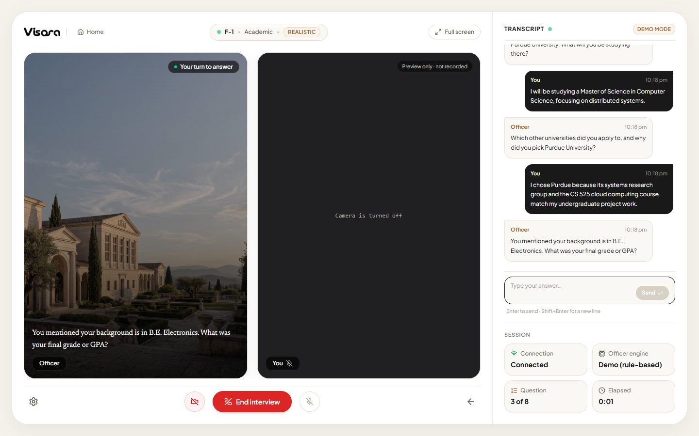
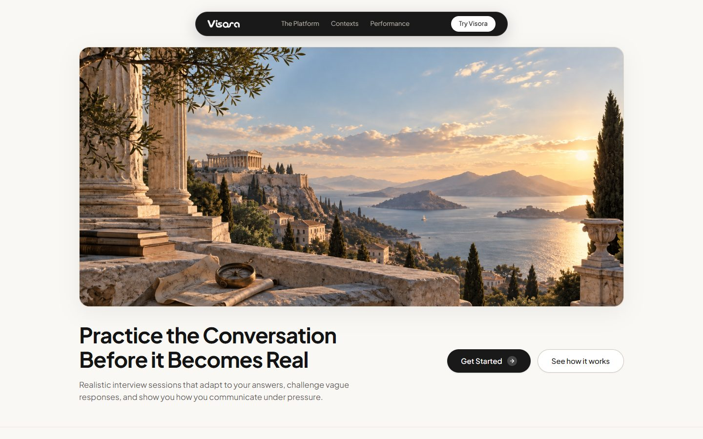
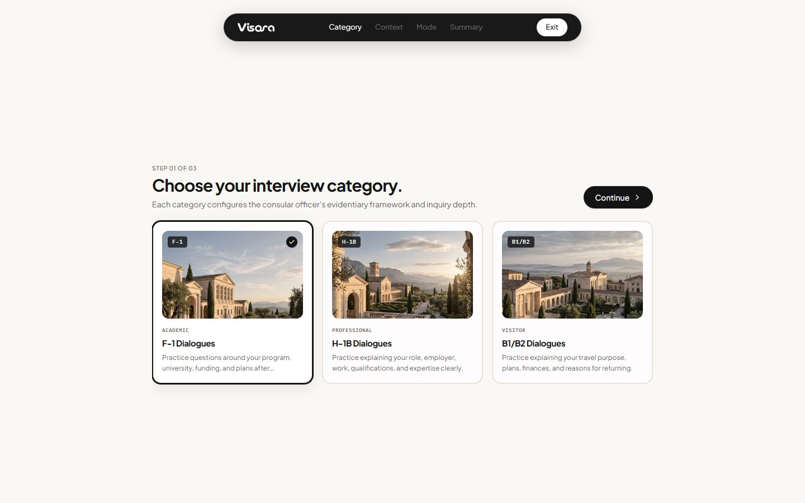
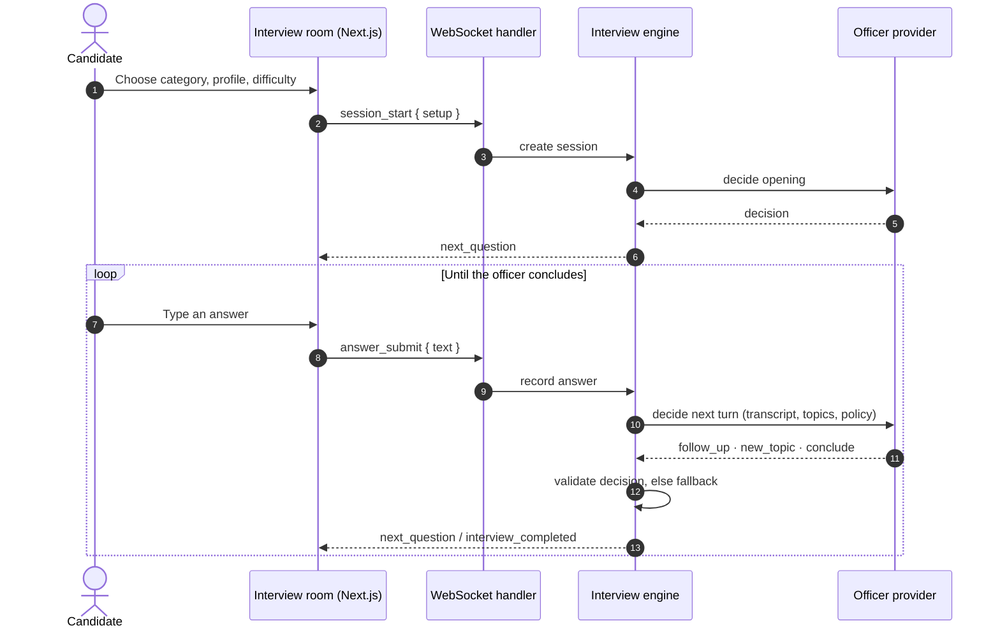
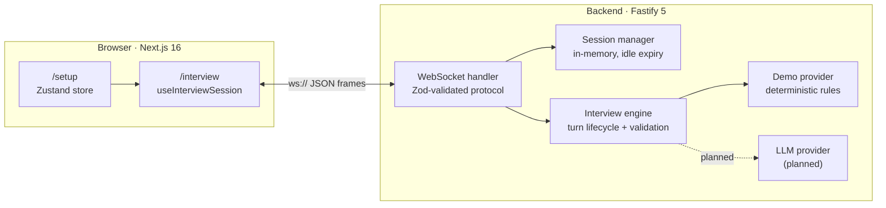

<div align="center">

<picture>
  <source media="(prefers-color-scheme: dark)" srcset="frontend/public/images/visora-logo-white.png">
  
</picture>

### Practice the conversation before it becomes real.

An adaptive AI interview environment for US visa interview practice — a consular officer that listens to your answers, probes what's vague, and remembers what you said.

<p>
  
  
  
  
  
  
  
  
</p>

<p>
  
  
</p>

<a href="#-quick-start">Quick start</a> ·
<a href="#-features">Features</a> ·
<a href="#-architecture">Architecture</a> ·
<a href="#-tech-stack">Tech stack</a> ·
<a href="#-project-status">Status</a> ·
<a href="#-roadmap">Roadmap</a> ·
<a href="docs/">Docs</a>

</div>

<br>

<p align="center">
  
</p>

<p align="center"><sub>A real F-1 session against the local backend in demo mode. The officer's follow-up uses the academic background entered during setup.</sub></p>

---

## ✦ What is Visora?

Most interview prep is a list of questions. A real visa interview is a **conversation**: the officer reacts to what you say, presses on weak answers, and moves on when you've made your case.

Visora simulates that conversation. You pick a visa category, fill in your profile, choose how tough the officer should be, and step into an interview room. The officer opens the interview, reads each answer, decides whether to probe deeper or move on, and closes the interview when it has heard enough.

| Category | Visa | The officer focuses on |
|---|---|---|
| **Academic** | F-1 Student | Program, university choice, funding, plans after graduation |
| **Professional** | H-1B Employment | Role, employer, qualifications, specialty occupation |
| **Visitor** | B1/B2 Business & Tourism | Trip purpose, itinerary, finances, ties to home |

> [!NOTE]
> Visora is a practice tool. It does not predict visa outcomes, give legal or immigration advice, or judge honesty. Feedback describes how you communicated, not whether you would be approved.

## ✦ Features

**Working today**

- 🗣️ **Adaptive officer** — every answer is analysed before the next question. Short, hedging ("I think…", "maybe") or detail-free answers get a follow-up; solid answers move the interview to a new topic.
- 🧠 **Stateful sessions** — the server tracks the transcript, covered topics, follow-ups per topic and the question budget. The officer never repeats a question and never revisits a closed topic.
- 🎚️ **Four difficulty modes** — `comfortable`, `realistic`, `strict` and `pressure` change the question budget, follow-up depth and how strictly vague answers are treated.
- ⚡ **Realtime protocol** — a typed, Zod-validated WebSocket protocol with rate limiting, origin checks, payload limits and idle expiry.
- 🔁 **Resilient connection** — drop your network or reload the page mid-interview and you rejoin the same session with the transcript intact.
- 🛡️ **Never stalls** — LLM-style decisions are validated before use; anything invalid, slow or failing falls back to the deterministic officer.
- 🔐 **Private by default** — the camera tile is a local preview only; nothing is recorded or uploaded, and the microphone is never accessed yet.
- 💸 **Runs for ₹0** — demo mode needs no API keys, no GPU and no paid service.

**Coming next** — see the [roadmap](#-roadmap): live LLM officer, results & analytics, voice conversation, and a MuseTalk lip-synced officer avatar.

<table>
  <tr>
    <td width="50%"></td>
    <td width="50%"></td>
  </tr>
  <tr>
    <td align="center"><sub>Landing page</sub></td>
    <td align="center"><sub>Setup — choose a category, profile and difficulty</sub></td>
  </tr>
</table>

## ✦ How an interview works



## ✦ Architecture



Design rules the code follows:

- **Business logic lives outside the transport.** The WebSocket handler parses and routes; the engine decides.
- **The model never owns state.** Providers *propose* a decision; the engine validates it against the session and interview rules before applying it.
- **Providers are swappable.** Anything implementing `InterviewProvider` can drive the officer — the demo rules today, an LLM next, without touching the engine or protocol.
- **Sessions are server-issued.** Clients never choose a session ID; a connection holds at most one session.

Deep dives: [Architecture](docs/architecture.md) · [Interview engine](docs/interview-engine.md) · [Realtime protocol](docs/realtime-protocol.md)

## ✦ Tech stack

| Layer | Technology | Used for |
|---|---|---|
| **Frontend** | [Next.js 16](https://nextjs.org) (App Router, Turbopack) · React 19 | Pages, routing, production build |
| | TypeScript (strict) | End-to-end typing |
| | Tailwind CSS 4 | Styling — light, editorial design system |
| | Zustand 5 | Persisted interview setup |
| | GSAP 3 | Landing page motion |
| | Lucide | Icons |
| | React Hook Form · Zod | Setup forms and validation |
| **Backend** | Node.js 20+ · [Fastify 5](https://fastify.dev) | HTTP server, health endpoint |
| | @fastify/websocket · ws | Realtime interview transport |
| | @fastify/cors | Origin-restricted CORS |
| | Zod 4 | Runtime validation of messages, setup and env |
| | Pino (via Fastify) | Structured logging |
| **Quality** | Vitest | Unit + WebSocket integration tests |
| | ESLint (`eslint-config-next`) · `tsc` | Linting and type checks |
| **Planned** | Groq free tier (Qwen3 / Llama 3.3) · OpenRouter `:free` | Live LLM officer |
| | Sarvam AI · browser Web Speech | Speech-to-text and text-to-speech |
| | MuseTalk 1.5 (Python service) | Lip-synced officer avatar |

The stack is chosen so the whole product can be developed and demoed **without spending money**. Paid or GPU-only pieces are optional and never required to run the app.

## ✦ Repository structure

```text
visora/
├── frontend/                      Next.js app
│   ├── app/
│   │   ├── page.tsx               Landing page
│   │   ├── setup/                 Category → profile → difficulty → summary
│   │   └── interview/             Interview room
│   ├── components/
│   │   ├── landing/               Hero, contexts, features, performance, footer…
│   │   ├── setup/                 Setup steps
│   │   ├── interview/             Transcript, answer composer, session stats, camera settings
│   │   └── navigation/            Floating navbar
│   ├── hooks/
│   │   └── use-interview-session.ts   WebSocket session lifecycle + reconnect
│   ├── lib/
│   │   ├── realtime/              Protocol types, room-state reducer, setup payload
│   │   ├── constants/             Contexts, navigation
│   │   └── mock/                  Sample data for landing-page previews only
│   ├── store/                     Zustand setup store
│   └── types/
│
├── backend/                       Fastify + WebSocket interview server
│   ├── src/
│   │   ├── server.ts · app.ts     Entry point and app factory
│   │   ├── config/env.ts          Validated environment config
│   │   ├── interview/             Contexts, engine, session manager, answer analysis
│   │   ├── llm/                   Provider interface + deterministic demo provider
│   │   └── websocket/             Protocol schema and socket handler
│   └── test/                      Vitest suites
│
└── docs/                          Technical documentation and screenshots
```

## ✦ Quick start

**Prerequisites:** Node.js 20+ and npm. No API keys, Docker, database or GPU.

```bash
git clone https://github.com/sn3hhaa/visora.git
cd visora
```

**1 · Backend** (terminal 1)

```bash
cd backend
npm install
npm run dev              # http://localhost:4000
```

**2 · Frontend** (terminal 2)

```bash
cd frontend
npm install
npm run dev              # http://localhost:3000
```

**3 · Interview**

Open <http://localhost:3000>, click **Get Started**, pick a category, fill in your profile, choose a difficulty and enter the room. Press **Start interview** and answer each question by typing.

Check the backend at any time:

```bash
curl http://localhost:4000/health
# {"status":"ok","service":"visora-backend","provider":"demo","activeSessions":0,...}
```

## ✦ Configuration

Both apps work with their defaults. To override, copy the example files:

```bash
cp backend/.env.example backend/.env
cp frontend/.env.example frontend/.env.local
```

**Backend** — [`backend/.env.example`](backend/.env.example)

| Variable | Default | Description |
|---|---|---|
| `HOST` / `PORT` | `0.0.0.0` / `4000` | Listen address |
| `LOG_LEVEL` | `info` | `fatal` … `trace`, or `silent` |
| `CORS_ORIGINS` | `http://localhost:3000` | Comma-separated origins allowed for HTTP and WebSocket |
| `LLM_PROVIDER` | `demo` | Officer provider (only `demo` exists so far) |
| `LLM_TIMEOUT_MS` | `15000` | Slower provider calls fall back to the demo officer |
| `SESSION_IDLE_TTL_MS` | `1800000` | Idle sessions expire after 30 min |
| `SESSION_SWEEP_INTERVAL_MS` | `60000` | How often expiry runs |
| `MAX_SESSIONS` | `200` | In-memory session cap |
| `WS_MAX_PAYLOAD_BYTES` | `65536` | Max WebSocket frame size |

**Frontend** — [`frontend/.env.example`](frontend/.env.example)

| Variable | Default | Description |
|---|---|---|
| `NEXT_PUBLIC_INTERVIEW_WS_URL` | `ws://localhost:4000/ws/interview` | Backend WebSocket (`wss://` in production) |

> [!IMPORTANT]
> Never commit `.env` files. They are git-ignored; only the `.env.example` templates are tracked.

## ✦ Scripts & testing

| Where | Command | What it does |
|---|---|---|
| `backend/` | `npm run dev` | Start with reload (tsx) |
| | `npm run build && npm start` | Compile to `dist/` and run |
| | `npm test` | Vitest: engine, session manager, answer analysis, env, WebSocket integration |
| | `npm run typecheck` | Type-check source and tests |
| `frontend/` | `npm run dev` | Next.js dev server |
| | `npm run build && npm start` | Production build and server |
| | `npm run lint` | ESLint |

The backend suite (45 tests) covers session creation, resume, expiry and capacity; engine decisions, validation and fallbacks; and the full WebSocket flow including invalid payloads, rate limiting and origin rejection. The frontend does not have automated tests yet; the interview flow has been verified manually and with a headless-browser run against the live backend for all three categories.

## ✦ Project status

Honest status — what runs today versus what is still being built.

| Area | Status | Notes |
|---|---|---|
| Landing page & setup flow | ✅ Done | Category, profile, difficulty, summary |
| Session manager & state machine | ✅ Done | In-memory, server-issued IDs, idle expiry, capacity cap |
| Realtime WebSocket protocol | ✅ Done | Validated, rate-limited, resumable — [spec](docs/realtime-protocol.md) |
| Adaptive demo officer | ✅ Done | Deterministic, rule-based; no API keys |
| Interview room ↔ backend | ✅ Done | Real transcript, reconnect & resume, typed answers |
| Live LLM officer | 🚧 Next | Groq free tier, structured output, demo fallback |
| Results & analytics | 🚧 Next | Measured metrics + AI-assisted feedback |
| Voice input / spoken officer | 📋 Planned | STT + TTS behind provider interfaces |
| MuseTalk avatar | 📋 Planned | Separate Python GPU service; officer tile is a static image today |
| Branded loader & favicon | 📋 Planned | Wordmark reveal, V monogram |
| CI & deployment | 📋 Planned | GitHub Actions, hosting guide |

What the UI labels as not-real-yet: the **Demo mode** badge marks the rule-based officer, the disabled microphone marks missing voice input, and the camera tile states it is a preview that is not recorded.

## ✦ Roadmap

1. **Results & analytics** — duration, word count, words per minute, response latency, filler words; question-by-question breakdown on a real results page.
2. **Live LLM officer** — OpenAI-compatible client (Groq free tier first), structured decisions validated by the existing engine, demo fallback on failure.
3. **Voice** — browser audio capture, streaming STT, officer TTS, turn-taking and interruption handling.
4. **MuseTalk 1.5 avatar** — a Python service that lip-syncs the officer's speech; tested on free notebook GPUs, with a clearly labelled fallback when no GPU is available.
5. **Polish** — branded VISORA loader, favicon, metadata, responsive and accessibility pass.
6. **Ship** — CI, end-to-end tests, deployment and cost documentation.

The full plan with phases and design decisions is in [docs/roadmap.md](docs/roadmap.md).

## ✦ Documentation

| Document | Covers |
|---|---|
| [Architecture](docs/architecture.md) | Components, data flow, state ownership, error handling |
| [Interview engine](docs/interview-engine.md) | Session state, decisions, validation, difficulty, demo rules |
| [Realtime protocol](docs/realtime-protocol.md) | Every WebSocket message, errors, lifecycle, reconnection |
| [Roadmap](docs/roadmap.md) | Phases, planned providers and design decisions |
| [Contributing](CONTRIBUTING.md) | Setup, branching, commit style, pull requests |

## ✦ Contributing

Contributions and feedback are welcome. Read [CONTRIBUTING.md](CONTRIBUTING.md) for local setup, coding standards and the [Conventional Commits](https://www.conventionalcommits.org) style this repo uses.

## ✦ License

No license has been chosen yet, so all rights are reserved by the author for now. An open-source license will be added before the first public release.

---

<div align="center">
<sub>Built by <a href="https://github.com/sn3hhaa">Sneha Tiwari</a> · Visora is not affiliated with the U.S. Department of State or any government agency.</sub>
</div>
