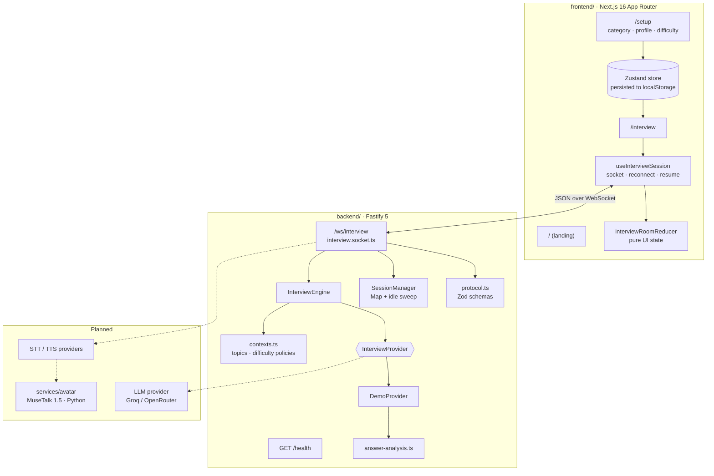

# Architecture

This document describes the system as it exists today, and marks clearly where planned components will plug in.

## Overview

## Frontend

| Piece | Location | Role |
|---|---|---|
| Landing page | `app/page.tsx`, `components/landing/` | Product story. Its conversation and analytics previews use sample data from `lib/mock/`, which is never used in the interview flow. |
| Setup flow | `app/setup/`, `components/setup/` | Four steps; writes to the persisted Zustand store (`store/interview-store.ts`). |
| Interview room | `app/interview/page.tsx`, `components/interview/` | Officer tile, local camera preview, transcript, answer composer, session facts. |
| Session hook | `hooks/use-interview-session.ts` | Owns the WebSocket: connect, keepalive, reconnect with backoff, resume after reload. |
| Room state | `lib/realtime/interview-state.ts` | Pure reducer from server messages to UI state; de-duplicates transcript entries. |
| Protocol types | `lib/realtime/protocol.ts` | Client mirror of the backend protocol. |

**State ownership.** The setup store owns *what the candidate chose*. The backend session owns *what happened in the interview*. The room reducer only reflects server messages: on resume, the server's snapshot replaces the local transcript.

## Backend

| Piece | Location | Role |
|---|---|---|
| App factory | `src/app.ts` | Registers CORS, WebSocket, `/health`, `/ws/interview`; wires dependencies. |
| Config | `src/config/env.ts` | Zod-validated environment; fails fast with a readable error. |
| Socket handler | `src/websocket/interview.socket.ts` | Rate limiting, JSON parsing, validation, routing to the engine, delivery to the attached socket. |
| Protocol | `src/websocket/protocol.ts` | Client message schemas and server message types. |
| Session manager | `src/interview/session-manager.ts` | In-memory sessions, UUID v4 IDs, idle expiry, capacity cap. |
| Engine | `src/interview/engine.ts` | Turn lifecycle, provider timeout, decision validation, fallback. |
| Contexts | `src/interview/contexts.ts` | F-1 / H-1B / B1/B2 topics, questions, probes; difficulty policies. |
| Providers | `src/llm/` | `InterviewProvider` interface and the deterministic `DemoProvider`. |

See [interview-engine.md](interview-engine.md) for decision rules and [realtime-protocol.md](realtime-protocol.md) for every message.

## Data flow of one turn

1. The candidate submits text; the hook sends `answer_submit`.
2. The socket handler validates the frame, checks the session phase, and records the answer (`transcript_update` goes back immediately).
3. It sends `agent_processing`, then asks the engine for the next turn.
4. The engine builds a `TurnRequest` (setup, transcript, topics, policy, remaining budget) and calls the provider with a timeout.
5. The provider returns a raw decision. The engine validates it; if invalid, slow or failing, it uses the demo provider's decision instead.
6. The engine updates the session (topic, follow-ups, question count, phase) and returns the officer entry.
7. The handler delivers `next_question` or `interview_completed` to whichever socket is attached to the session now. After a resume, that may be a different connection.

## Error handling

| Failure | Behaviour |
|---|---|
| Invalid frame or field | `error` reply (`invalid_json`, `invalid_message`, `unsupported_message`); connection stays open. |
| Message flood | `rate_limited` above 30 msgs / 10 s; socket closed with `1008` at twice that. |
| Provider error or timeout | Logged; deterministic fallback decision. The interview continues. |
| Disallowed origin | Upgrade closed with `1008`. |
| Network drop | Session kept until idle expiry; client reconnects with backoff and sends `session_resume`. |
| Same session opened elsewhere | Old socket closed with `4000`; client shows "opened in another tab" and does not reconnect. |
| Backend unreachable at start | Client returns to the idle state with an explanatory error. |
| Unexpected exception | `internal` error to the client; details only in server logs. |

## Privacy

- Sessions live only in backend memory and are deleted after idle expiry. There is no database.
- The camera stream never leaves the browser. The microphone is not accessed.
- Logs record session IDs, contexts and difficulty, not answer text.

## Planned extensions

- **LLM provider:** a new `InterviewProvider` implementation selected by `LLM_PROVIDER`. The engine and protocol stay unchanged.
- **Voice:** new protocol events (`audio_*`, `stt_*`, `tts_*`) behind STT/TTS provider interfaces, so Sarvam, browser speech or local models can be swapped.
- **Avatar:** a separate Python service (`services/avatar`), because MuseTalk needs a GPU and PyTorch. The interview keeps working without it.
- **Scaling:** the session manager is the single seam to replace with Redis if more than one backend process is ever needed.
