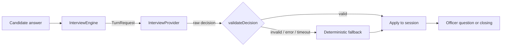

# Interview engine

The engine decides what the AI officer says next. It lives in [`backend/src/interview`](../backend/src/interview) and is independent of any particular LLM.

## Pieces

| File | Responsibility |
|---|---|
| `contexts.ts` | Interview contexts (F-1, H-1B, B1/B2): officer brief, ordered topics, demo question bank, opening/closing lines. Difficulty policies. |
| `session-manager.ts` | In-memory sessions with server-issued UUIDs, idle expiry and a capacity cap. |
| `engine.ts` | Turn lifecycle, provider call with timeout, decision validation, state updates. |
| `answer-analysis.ts` | Cheap heuristics on an answer: word count, hedging phrases, presence of concrete detail. |
| `../llm/provider.ts` | `InterviewProvider` interface and the decision schema. |
| `../llm/demo-provider.ts` | Deterministic rule-based officer used in demo mode and as the fallback. |

## Session state

Each session tracks the setup (context, difficulty, profile), the transcript, the question count, the current topic, covered topics, follow-ups per topic, and its phase (`awaiting_answer` → `processing` → … → `completed`).

## Decisions

A provider returns one of:

| `action` | Meaning |
|---|---|
| `opening` | First question of the interview. |
| `follow_up` | Probe the current topic further. |
| `new_topic` | Move to an uncovered topic. |
| `conclude` | End the interview with a closing remark. |

The engine never trusts provider output. `validateDecision` rejects a decision if it:

- fails the schema (missing fields, empty or over-long question);
- repeats a question already asked (case and punctuation insensitive);
- moves to an unknown or already-covered topic;
- exceeds the per-topic follow-up limit;
- concludes before 3 questions while topics remain, or continues after the question budget is spent.

A rejected decision, a thrown error or a timeout (`LLM_TIMEOUT_MS`) all fall back to the deterministic officer, so the interview never stalls.

## Difficulty

| Mode | Max questions | Follow-ups per topic | "Too short" below | Probes hedging |
|---|---|---|---|---|
| `comfortable` | 6 | 1 | 8 words | no |
| `realistic` | 8 | 1 | 12 words | yes |
| `strict` | 9 | 2 | 15 words | yes |
| `pressure` | 10 | 2 | 18 words | yes |

Each mode also has a `tone` description intended for LLM prompts.

## Demo provider rules

In order, for the current topic (while follow-ups remain):

1. Answer shorter than the mode's threshold → ask the candidate to elaborate (wording depends on mode), then the topic's specifics probe.
2. Hedging phrase ("I think", "maybe", "not sure", …) and the mode probes hedging → ask for a definite answer.
3. No concrete detail (numbers, amounts, proper nouns) → the topic's specifics probe.

Otherwise it moves to the next uncovered topic in order, and concludes when topics or the question budget run out. The rules are deterministic, so the same answers always produce the same interview — useful for demos and tests.

These are heuristics. The demo provider cannot judge whether an answer is relevant to the question or spot contradictions; that is the job of the live LLM provider.

## Adding a context

Add a `ContextDefinition` to `contexts.ts`, extend `interviewContextIdSchema` and `interviewSetupSchema` in `types.ts` with its profile schema, and add the matching frontend setup form.
