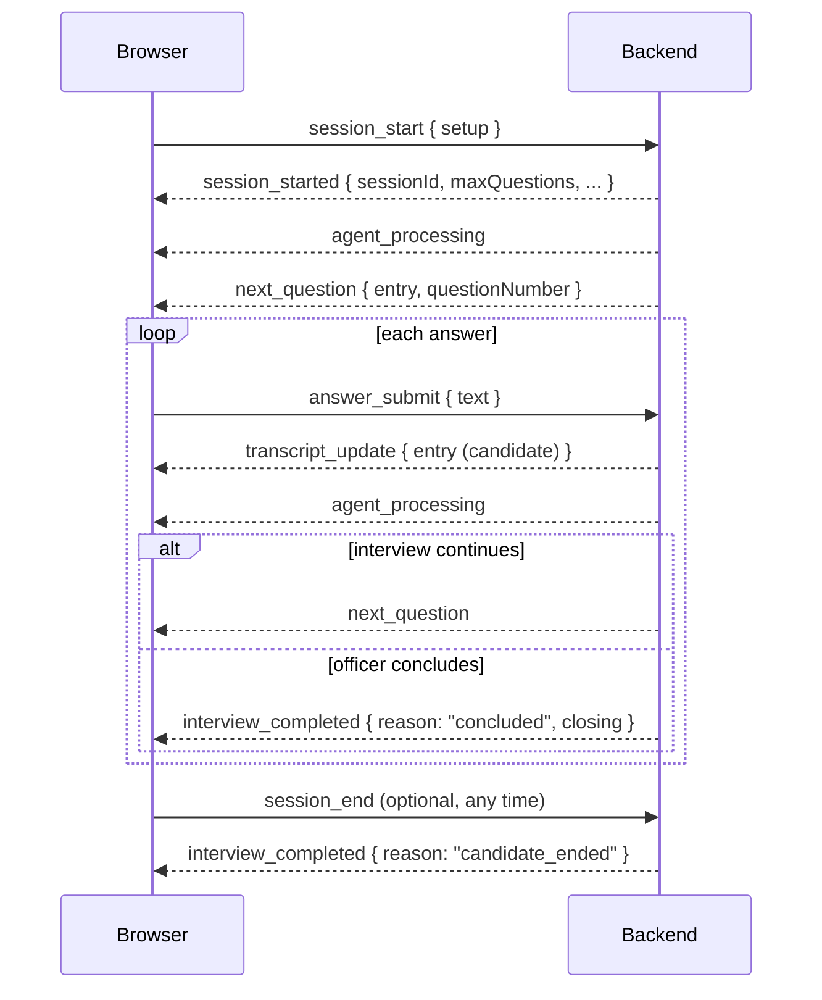

# Realtime protocol

The interview runs over a single WebSocket per browser tab.

- **Endpoint:** `ws://<backend>/ws/interview` (`wss://` in production)
- **Encoding:** JSON text frames. Binary frames are rejected (audio streaming will extend the protocol in a later version).
- **Version:** `1`, reported as `protocolVersion` in `session_started`.
- **Source of truth:** [`backend/src/websocket/protocol.ts`](../backend/src/websocket/protocol.ts). Client messages are validated with Zod; anything that fails validation gets an `error` reply and is otherwise ignored.

## Lifecycle



A connection holds at most one session. Sessions are created by the server; the client never chooses an ID.

## Client → server

| `type` | Fields | Notes |
|---|---|---|
| `session_start` | `setup` | Creates a session and triggers the opening question. |
| `session_resume` | `sessionId` | Re-attaches to an existing session after a dropped connection. Any other socket attached to that session is closed with code `4000`. |
| `answer_submit` | `text` (1–4000 chars, trimmed) | Only accepted while the session is awaiting an answer. |
| `session_end` | — | Ends the interview. Idempotent. |
| `ping` | — | Replies with `pong`. |

`setup` mirrors the frontend's setup store:

```json
{
  "context": "f1",
  "difficulty": "realistic",
  "profile": { "university": "Purdue University", "program": "M.S. Computer Science", "academicBackground": "B.E. Electronics" }
}
```

| `context` | `profile` fields |
|---|---|
| `f1` | `university`, `program`, `academicBackground` |
| `h1b` | `employer`, `role`, `experience` |
| `b1b2` | `purpose`, `duration`, `destination` |

Profile fields are optional strings (max 500 chars). `difficulty` is one of `comfortable`, `realistic`, `strict`, `pressure`.

## Server → client

| `type` | Fields |
|---|---|
| `session_started` | `protocolVersion`, `provider`, `resumed`, `sessionId`, `context`, `difficulty`, `phase`, `questionCount`, `maxQuestions`, `transcript` |
| `agent_processing` | — (the officer is deciding the next turn) |
| `next_question` | `entry`, `questionNumber`, `maxQuestions` |
| `transcript_update` | `entry` (the candidate's accepted answer) |
| `interview_completed` | `sessionId`, `reason` (`concluded` \| `candidate_ended` \| `expired`), `closing` (officer entry or `null`) |
| `error` | `code`, `message`, `recoverable` |
| `pong` | — |

A transcript `entry` is:

```ts
{ id: string; role: "officer" | "candidate"; text: string; at: string /* ISO 8601 */;
  kind?: "opening" | "follow_up" | "new_topic" | "closing"; topicId?: string }
```

`phase` is `awaiting_answer`, `processing` or `completed`.

## Errors

| `code` | When |
|---|---|
| `invalid_json` | Frame is not JSON. |
| `unsupported_message` | Unknown `type`. |
| `invalid_message` | Known `type` but fields fail validation. |
| `no_session` | Session message sent before `session_start`/`session_resume`. |
| `session_exists` | A second `session_start`/`session_resume` on the same connection. |
| `session_not_found` | Unknown or expired session (`recoverable: false`). |
| `session_completed` | Answer sent after the interview ended. |
| `busy` | Answer sent while the officer is still processing. |
| `capacity` | Server is at `MAX_SESSIONS`. |
| `rate_limited` | More than 30 messages in 10 s. At twice that, the socket is closed with `1008`. |
| `internal` | Unexpected server error (logged server-side). |

## Connection handling

- **Origin check:** browser upgrades whose `Origin` is not in `CORS_ORIGINS` are closed with `1008`.
- **Payload limit:** frames above `WS_MAX_PAYLOAD_BYTES` (64 KiB) are rejected by the WebSocket layer.
- **Disconnects:** closing the socket does not end the interview. The session stays in memory until it has been idle for `SESSION_IDLE_TTL_MS` (30 min), so the client can `session_resume`. An officer turn that completes after a resume is delivered to the new connection.
- **Expiry:** idle sessions are swept every `SESSION_SWEEP_INTERVAL_MS` and marked `expired`.
